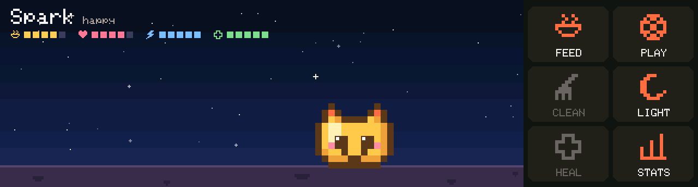
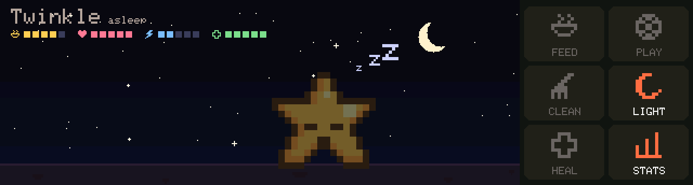
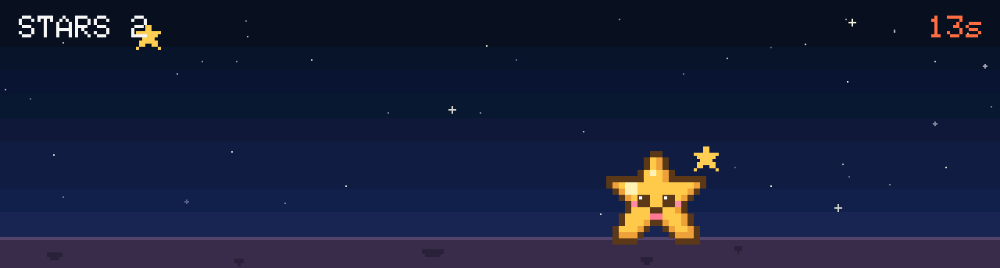
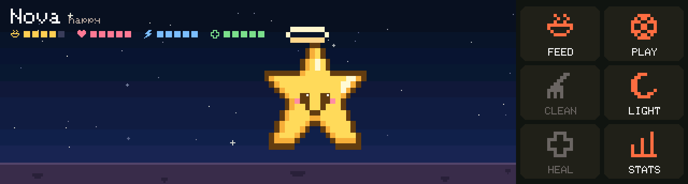

# Starling

A pocket star to look after. Starling is a virtual-pet firmware for the
**Waveshare ESP32-S3-Touch-LCD-3.49** (the board behind the RSVP Nano reader): a tiny star
creature hatches from an egg, lives on a little moon under a night sky, and grows up into one of
four forms depending on how you care for it.






## Playing

| | |
|---|---|
| **Feed** | A *meal* fills it up; a *snack* is a treat that cheers it up (too many and it gets heavy). |
| **Play** | *Star catch*: drag left and right to catch falling stars for 20 seconds. More stars, more joy. |
| **Clean** | Dust bunnies pile up over time. Swipe across them to sweep them away. |
| **Light** | Turn the lights off when it's tired so it can sleep properly. |
| **Heal** | Medicine when it looks green and sweaty. Don't give it when it's well. |
| **Stats** | Food, joy, energy, health, age, weight and care mistakes. Start a new egg from here. |

Rub the starling to pet it. A blinking **!** means it needs something; leaving a need unanswered
for 15 minutes counts as a care mistake.

**Growing up:** Egg → **Spark** (about 1½ minutes) → **Twinkle** (40 minutes) → grown star
(8 hours of on-time). How you raised it decides the form:

| Form | How |
|---|---|
| **Nova**, gold with a halo | Few care mistakes and a happy childhood |
| **Comet**, icy blue with a tail | Played with a lot |
| **Nebula**, purple with drifting motes | Slept a lot |
| **Dim**, grey | Many care mistakes. It can still be loved. |

Nothing dies. Time only passes while the device is on; switching off puts your starling to sleep.

**Buttons:** BOOT opens stats / closes menus. PWR toggles the screen; hold PWR for 2 seconds to
save and power off. The screen dims after a minute and switches off after three.

## Building

Uses [PlatformIO](https://platformio.org/).

```bash
pio run -e lcd349_rev2 -t upload        # Rev2 boards (V2.0 on the PCB)
pio run -e lcd349_rev1 -t upload        # Rev1 boards
pio test -e native                      # game-rule tests on your computer
pio run -e sim && .pio/build/sim/program screenshots   # render every scene to PNG
```

Flashing Starling replaces whatever firmware is on the board (such as the RSVP Nano reader). It uses
the same partition layout, so switching back by flashing the reader again keeps the reader's
settings, and Starling never touches the SD card.

## How it's built

- `src/game/`: the pet's rules (needs, care, sleep, sickness, evolution). Pure C++ with no hardware code.
- `src/ui/`: screens, touch handling, animation and pixel art, drawn through a tiny `gfx::Canvas`.
- `src/board/`: display, backlight, touch, buttons, battery and power latch for the LCD 3.49.
- `src/sim/`: a desktop simulator that runs the real game and UI code and writes screenshots.

## Credits

- Board bring-up (pin map, Rev2 reset sequence, touch protocol, power hold) adapted from
  [RSVP Nano](https://github.com/ionutdecebal/rsvpnano) (MIT).
- Display driver: [Arduino_GFX](https://github.com/moononournation/Arduino_GFX).
- The 5×7 pixel font is the classic Adafruit GFX font (BSD, © Adafruit Industries).

MIT licensed. See [LICENSE](LICENSE).
